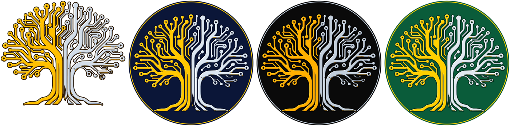

# KinNoKi tree, flat SVGs

These are flat vector versions of the gold-and-silver circuit tree from `Resources/logo.png`. They show only the tree, not the wordmark. Gold is on the left and silver on the right, as in the original. Each one has a dark outline and a light and dark edge that hints at the metal bevel. The colours are saturated golds and silvers.



| File | Gold | Silver | Background |
|---|---|---|---|
| `kinnoki-tree-money-bin.svg` | `#FFC000` | `#D3DDE8` | none (die-cut tree, dark brown outline) |
| `kinnoki-tree-vault-navy.svg` | `#FFC800` | `#DCE6F1` | navy disc, gold ring |
| `kinnoki-tree-doubloon-black.svg` | `#FFB000` | `#C2CEDB` | black disc, silver ring |
| `kinnoki-tree-emerald-vault.svg` | `#FFD000` | `#E1E8EF` | emerald disc, gold ring |

## Where to use them

- **Stickers, print and merch.** They work in the sticker-sheet skill, which is in the private claude-skills repo. Print them 60 mm or larger, because below that the finest traces get thinner than 1 mm.
- **Social avatars.** Use the round badges.
- **Not as the website logo or favicon.** Each file is about 650 KB, because the tree has a lot of detail, and at icon sizes the traces turn to mush. A logo for the web would need a simplified redraw.

## Remaking them

```sh
python3 docs/brand/kinnoki-tree/trace_tree.py
```

The script traces only the bright top faces of the 3D render. It tells gold from silver by warmth (red minus blue), which keeps gold's pale highlights gold. To change or add a scheme, edit `SCHEMES` in the script.

Known limits: a few shaded ring pads at the bottom right come out as partial rings. The shapes follow the render, so they are slightly irregular, not geometric.
